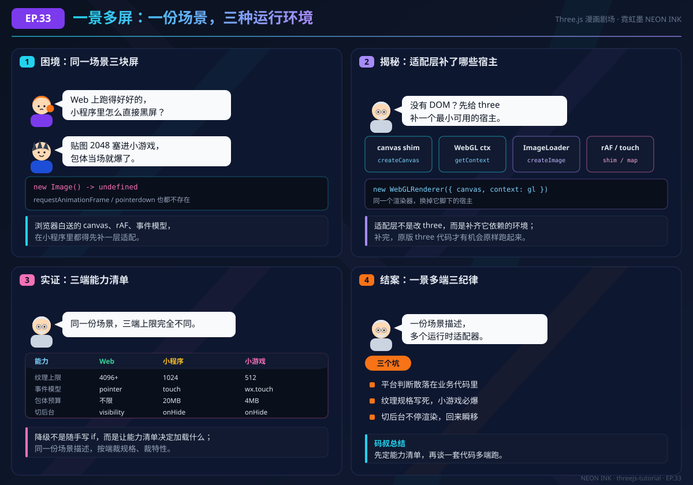

# EP.33 一套场景，多块屏幕

> **对应正文**：[33.1 基础入门：Vue 3 + TresJS 声明式 3D](../guide/33-cross-platform/basics.md)
> **延伸阅读**：[33.2 进阶应用：小程序 / 小游戏端的三.js 适配](../guide/33-cross-platform/advanced.md) · [33.3 实战案例：一套场景多端交付](../guide/33-cross-platform/practice.md)
> **动手演示**：[declarative-vs-imperative 声明式 vs 命令式](../public/demos/cross-platform/declarative-vs-imperative.html) · [platform-adapter-lab 平台约束模拟器](../public/demos/cross-platform/platform-adapter-lab.html) · [multitarget-lab 多端交付台](../public/demos/cross-platform/multitarget-lab.html)

## 剧情回顾

| 格 | 画面 | 关键对白 | 梗 / 记忆点 |
| --- | --- | --- | --- |
| 1 | 像素酱在 Web 上信心满满，切到小程序直接黑屏；标签君抱着 2048 贴图 | "Web 上跑得好好的，小程序里怎么直接黑屏？" / "贴图 2048 塞进小游戏，包体当场就爆了。" | 浏览器白送的 `new Image()`、`requestAnimationFrame`、`pointerdown`，换端全要自己补 |
| 2 | 码叔推了推眼镜，画出四块拼图：canvas shim、WebGL ctx、ImageLoader、rAF / touch | "没有 DOM？先给 three 补一个最小可用的宿主。" | 适配层的本质是"补宿主"，不是"改 three" |
| 3 | 三端能力清单摊在桌上：纹理、事件、包体、切后台 | "同一份场景，三端上限完全不同。" | 降级靠能力清单，不靠散落各处的 `if` |
| 4 | 码叔总结三条纪律，标签君把坑点贴到墙上 | "先定能力清单，再谈一套代码多端跑。" | 平台判断、纹理规格、后台不停渲染，是跨端三连坑 |

## 知识点拆解

### 1. 浏览器不是"默认环境"，只是其中一种宿主

Three.js 写的是一套与宿主无关的渲染抽象，但它默认依赖浏览器的几样东西：`window`、`document.createElement('canvas')`、`new Image()`、`requestAnimationFrame`、Pointer Events。Web 端这些能力是白送的，小程序 / 小游戏则要自己补。适配层的工作就是把这些"默认环境"补回来，让原版 three 代码以为自己还在浏览器里。

### 2. 适配层要补的是一条链，而不是一个点

`canvas` 与 `WebGLRenderingContext` 只是第一层。真正的资产链还包括：图片加载（`ImageLoader`）、文件加载（`FileLoader` / glTF）、动画循环（rAF 补丁）、事件（触摸映射）、生命周期（`onHide` / `onShow`）。只补 canvas 不补加载器，场景能亮但贴图全是黑的；只补加载器不补 rAF，画面永远停在第一帧。

### 3. 能力清单是跨端的"单一事实来源"

能力清单描述当前环境支持什么：最大纹理、DPR 上限、有没有实时阴影、用哪种事件模型、包体预算是多少。场景描述只写"要什么"，运行时按清单决定"给多少"。这样同一份场景在三端都能执行，而不是在业务代码里写三套分支。

### 4. 跨端不是同端降级

㉕ 的降级阶梯是同一浏览器里"关特效、降 DPR"；跨端是换掉整个运行环境：DOM 没了、加载器换了、事件换了、生命周期换了、包体有硬上限。所以跨端的架构单位不是"一个场景一条阶梯"，而是"一份场景描述 + 多个运行时适配器"。

## 常见误区

- **误区一：把 TresJS 直接搬到小程序。** TresJS 的宿主是浏览器 DOM，`TresCanvas` 依赖 `document`、`ResizeObserver` 和标准事件模型，小程序端不能照搬；它更适合作为 Web 运行时的那一层。
- **误区二：只补 canvas，不补加载器。** 贴图黑、模型空、字体不显示，八成是 `ImageLoader` / `FileLoader` 还在走浏览器实现。
- **误区三：切后台只停循环，不释放资源。** 后台占着纹理与 RenderTarget，iOS 上更容易被系统回收，回来时可能直接上下文丢失。
- **误区四：纹理规格跟着美术走。** 2048 贴图在 Web 上没问题，进了 4MB 主包的小游戏就是事故。

## 自测

<b>Q1：适配层最该先补哪三个接口？</b>

优先补 `canvas` + `WebGLRenderingContext`（让渲染器能创建）、`Image` / 图片加载（让纹理能上传）、`requestAnimationFrame`（让循环能跑）。这三条打通，才能看到"有画面的场景"；之后再补文件加载、触摸事件、生命周期与上下文恢复。

<b>Q2：为什么小程序里 `delta` 会突然变得很大？</b>

因为切后台期间渲染循环没有真正暂停，或暂停后没有重置计时器，恢复时 `delta` 累计了整段后台时间。修复方式是 `onHide` 停循环，`onShow` 先重置计时器再恢复，让逻辑时间从暂停点继续。

<b>Q3："一套代码多端跑"最现实的做法是什么？</b>

把可复用的部分抽成"场景描述 + 能力清单 + 运行时接口"，平台差异全部收敛到适配器。业务层只依赖 `RuntimeAdapter` 的挂载、逐帧、尺寸、暂停、恢复、销毁、输入这几个方法，不直接写平台判断。这样 Web 端可以用 Vue + TresJS，小程序端换 three 适配层，场景描述仍然是同一份。

---

> 下一篇正文见 [33.1 基础入门：Vue 3 + TresJS 声明式 3D](../guide/33-cross-platform/basics)。漫画仅作概念预热，代码与验收细节以正文为准。
