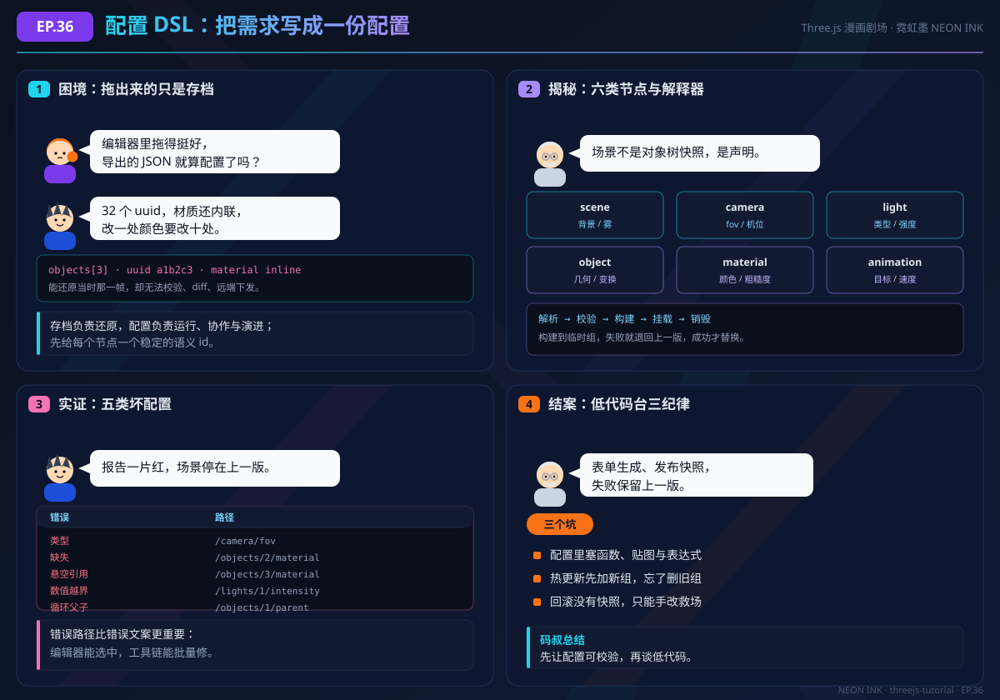

# EP.36 把需求写成一份配置

> **对应正文**：[36.1 基础入门：场景配置 DSL 与运行时解释器](../guide/36-config-platform/basics.md)
> **延伸阅读**：[36.2 进阶应用：校验、版本与热更新](../guide/36-config-platform/advanced.md) · [36.3 实战案例：低代码配置台](../guide/36-config-platform/practice.md)
> **动手演示**：[schema-lab DSL 解释器台](../public/demos/config-platform/schema-lab.html) · [validator-lab 配置校验工作台](../public/demos/config-platform/validator-lab.html) · [lowcode-builder-lab 低代码配置台](../public/demos/config-platform/lowcode-builder-lab.html)

## 剧情回顾

| 格 | 画面 | 关键对白 | 梗 / 记忆点 |
| --- | --- | --- | --- |
| 1 | 像素酱在编辑器里拖得心满意足，导出的 JSON 里全是 uuid；标签君抱着内联材质叹气 | "导出的 JSON 就算配置了吗？" / "改一处颜色要改十处。" | 能还原那一帧，不等于能被校验、diff、远端下发 |
| 2 | 码叔在玻璃板上写出六类节点：scene、camera、light、object、material、animation | "场景不是对象树快照，是六类节点的声明。" | 解释器五步：解析 → 校验 → 构建 → 挂载 → 销毁 |
| 3 | 标签君指着五类坏配置：类型、缺失、悬空引用、越界、循环父子 | "报告一片红，场景停在上一版。" | 路径式报错 `/objects/3/material` 比一句 invalid 有用 |
| 4 | 码叔收束低代码台三条纪律，标签君把坑点贴到墙上 | "先让配置可校验，再谈低代码。" | 不塞函数与贴图、先建后换、回滚要有快照 |

## 知识点拆解

### 1. 存档与配置，字段长得像，契约完全不同

编辑器导出的 JSON 记录的是"内部状态"：对象带 `uuid`、坐标是绝对的、材质被内联、父子关系藏在场景树下标里。它能回答"那一刻长什么样"，却回答不了"这个对象叫什么、换端怎么缩放、改色会不会漏、旧版本还能不能读"。配置要做的是把"意图"抽出来：稳定的语义 `id`、相对父节点的变换、按 `id` 引用的材质、显式的版本号与默认值。两者的目标不同，不能因为"都是 JSON"就直接复用。

### 2. DSL 的能力要刻意有限

场景配置不需要图灵完备。它应该只允许有限的节点类型，只写数据不写行为，引用而不是拷贝，层级而不是全量世界坐标。尤其不能塞进去两样东西：函数与 GPU 资源。函数会破坏跨端、校验、diff 与安全；贴图和模型应该写成 `assetId`，由运行时的资源表解析。行为用"类型 + 参数"表达，例如旋转写成 `type: "spin"` 加 `axis` 与 `speed`，由解释器里的构建器实现。

### 3. 解释器的价值在"失败也可控"

解释器不是"把 JSON 变对象"的工具函数，而是一条有阶段、有失败策略的流水线：解析失败给出字符位置；校验失败给出路径、期望类型与实际值；构建先落到临时组；挂载时原子替换；销毁时显式释放几何、材质与贴图。这样热更新失败时，用户看到的仍然是上一份能跑的配置，而不是半新半旧的黑屏。幂等重建是热更新的前提：同一份配置执行两次，场景节点数量不能增加。

### 4. 校验、版本与低代码，是同一件事的三层

36.2 把"加载前拦截"做厚：语法、结构、语义三层校验，严格与宽松两种模式，`version` 加单向迁移链，配置级开关与灰度，原子热更新与审计日志。36.3 再把它们组装成低代码台：字段由 schema 生成控件，表单与 DSL 双向同步，预览共用生产管线，发布即快照、回滚有目标，发布前给出影响面提示。配置化不是"让所有人写 JSON"，而是让不写代码的人也能安全地改场景。

## 常见误区

- **误区一：把编辑器存档直接当线上配置。** uuid 不稳定、坐标是绝对的、材质内联，改一处漏十处，diff 全是噪声。
- **误区二：在配置里写表达式或 Shader。** 看起来灵活，实际失去了静态校验、安全下发与跨端一致性；应该做成受控类型或代码插件。
- **误区三：宽松模式静默补默认值。** 用户看到的画面与配置文本对不上，上游的序列化 bug 也被掩盖；修正项必须回显并上报。
- **误区四：热更新先加新组、忘了删旧组。** 每更新一次叠一层，帧率逐次下降；正确顺序是先构建临时组，替换后再销毁旧组。

## 自测

<b>Q1：为什么编辑器导出的 JSON 不能直接当运行时配置？</b>

因为它记录的是编辑器内部状态，而不是场景意图。三个硬伤：`uuid` 每次导入都会变，无法做稳定引用与 diff；坐标是绝对世界坐标，换端或整体改布局要重算；材质内联且没有默认值，改一处颜色要改多处。配置需要语义化 `id`、相对父节点的变换、按 id 引用与版本字段，才能承担校验、协作与远端下发。

<b>Q2：为什么配置里不能塞函数、Shader 或 base64 贴图？</b>

函数与 Shader 源码无法被 schema 静态校验，无法安全地远端下发，也无法跨端保证执行环境一致，还会让 diff 与审计失效。base64 贴图会让配置体积膨胀、破坏缓存与并行加载。正确做法是把行为收敛成"受控类型 + 参数"，把资产写成 `assetId`，由运行时的构建器与资源表解析。需要真正可编程能力时，走代码插件发布流程，而不是配置下发。

<b>Q3：热更新怎样做到"失败也不黑屏"？</b>

按固定顺序执行：拉取配置并记录单调递增的 revision；解析、迁移、校验；预加载新增资产；构建到一个临时组；确认无误后再替换场景中的旧组；替换完成后销毁旧组；首帧渲染后确认，异常则回滚到 lastGood。任何一步失败都保留上一版，绝不把半成品挂到场景里。晚到的旧 revision 响应直接丢弃，避免旧配置覆盖新配置。

---

> 下一篇正文见 [36.1 基础入门：场景配置 DSL 与运行时解释器](../guide/36-config-platform/basics.md)。漫画仅作概念预热，代码与验收细节以正文为准。
